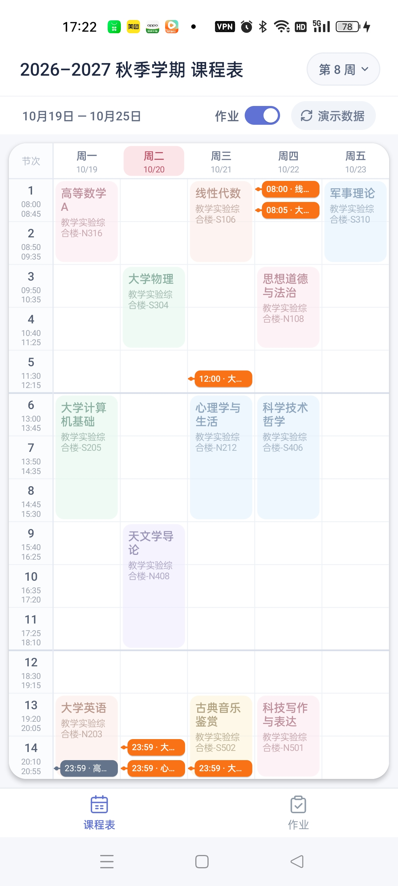
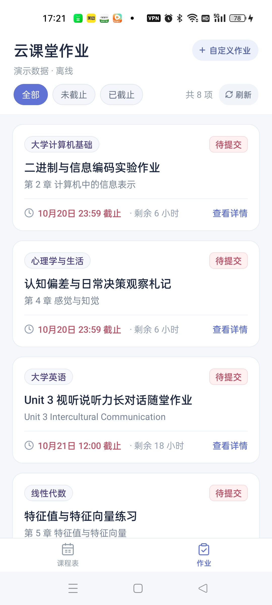
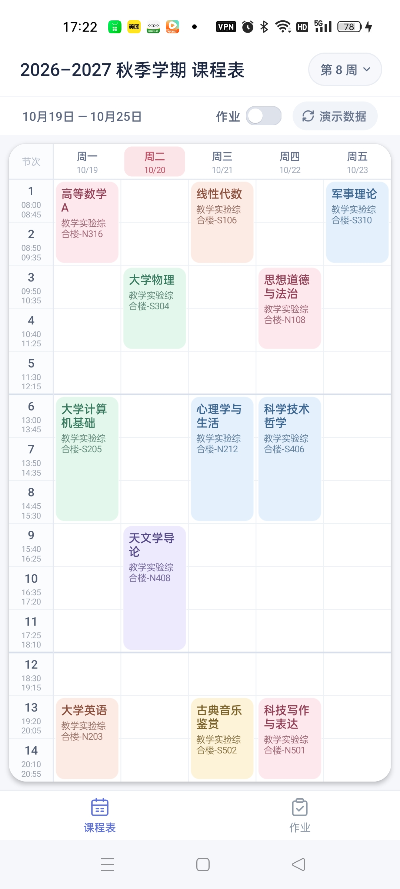
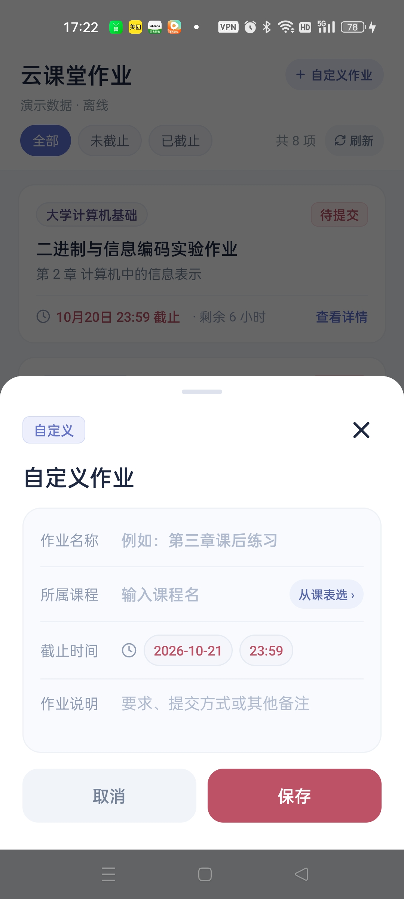
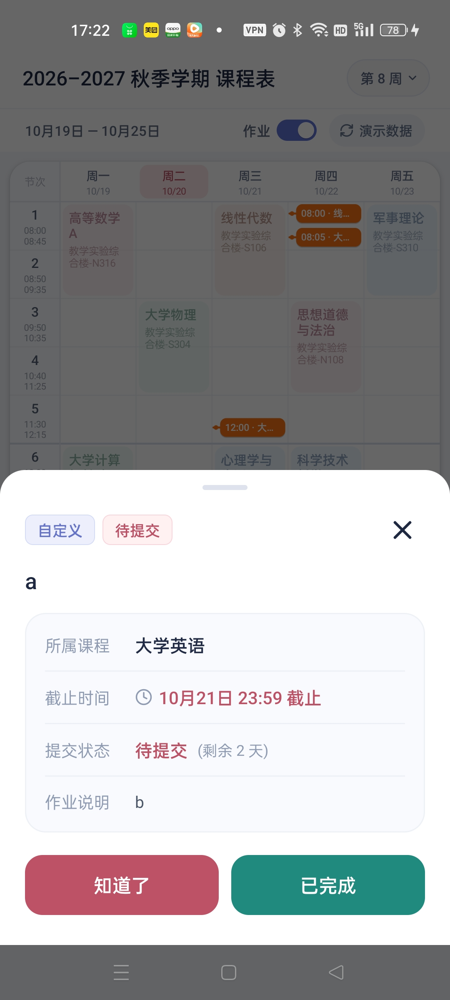

# 北邮课表 · BUPT Class Schedule

**今天上什么课、在哪间教室、作业几点截止，一张课表就能看清。**

北邮课表是一款面向北京邮电大学本科生的原生 Android 应用。它从学校教务系统获取课程安排，从云课堂读取作业与测验，也支持自己添加任务，把上课和交作业这两件事放到同一张时间表里。

**Android 6.0 及以上** · **目前支持本科生教务** · **个人开发的非官方应用**

## 下载与安装

**[下载正式版 v1.0.3 APK](https://github.com/ofyc-666/bupt-class-schedule/releases/download/v1.0.3/BUPT-Class-Schedule-v1.0.3.apk)** · [SHA-256 校验文件](https://github.com/ofyc-666/bupt-class-schedule/releases/download/v1.0.3/SHA256SUMS.txt) · [最新正式版](https://github.com/ofyc-666/bupt-class-schedule/releases/latest) · [查看所有版本](https://github.com/ofyc-666/bupt-class-schedule/releases)

下载 APK 后在 Android 手机上安装。已有正式版可使用相同签名的新版 APK 覆盖安装，保留本地账号与缓存数据。

## 界面预览

以下截图使用脱敏演示数据，展示课表、作业以及自定义任务的实际界面。

| 课表上的作业截止时间 | 作业与测验列表 | 每周课程表 |
| :---: | :---: | :---: |
|  |  |  |

| 创建自定义作业 | 查看作业详情 |
| :---: | :---: |
|  |  |

## 主要功能

### 一张课表，看到整周安排

登录教务后，应用按当前教学周显示课程名称、教室和上课节次，涵盖上午、下午和晚间课程。可以切换教学周，也可以横向滑动查看周六、周日。

点击课程块，可查看任课教师、教学班、教室以及具体上课时间。当天和当前周次会随日期变化更新。

### 把 DDL 直接放在课程时间轴上

打开课表上方的「作业」开关，尚未完成的作业和测验会以彩色时间标记显示在对应日期的课表中，点击即可查看详情。

- **分钟级定位**：上课时间段内按实际分钟映射位置；课间和课表时间范围外采用边界吸附。
- **智能避让**：多个截止时间靠得很近时，使用 PAVA（保序回归）调整标记位置，尽量减少偏移并保持先后顺序；空间不足时聚合显示，仍可点开查看。
- **状态区分**：已截止任务使用不同的视觉提示，方便快速辨认。

课表的课程卡片会在显示任务时淡化，让 DDL 更醒目；关闭开关即可恢复普通课表视图。

### 云课堂同步 + 本地自定义作业

作业页可以同步学校云课堂（UCloud）中可读取的普通作业和测验，集中查看课程、任务名称、截止时间、剩余时间及提交状态，并按「全部」「未截止」「已截止」筛选。

也可以点击「+ 自定义作业」创建自己的待办任务：填写名称、选择或输入课程、设置截止日期与时间，补充作业说明。适合记录实验报告、线下布置的任务等；自定义任务完成后可点击「已完成」，从待办任务中移除。

所有任务的截止时间统一采用明确日期：例如 `10月21日 23:59`，跨年时显示年份，例如 `2027年1月2日 23:59`。剩余天数或小时数会随时间更新。

### 长作业说明也能完整查看

作业详情显示所属课程、截止时间、提交状态和可读取的说明内容。详情弹窗会根据内容调整高度，长说明可以上下滚动，底部操作按钮保持可见。

## 开始使用

1. **登录教务**：输入学号及教务密码，获取当前学期课表。首次使用也可以先不填写云邮密码。
2. **配置云邮**：需要查看云课堂作业时，在登录界面或作业页配置云邮密码；也可以从课表「作业」开关进入配置流程。
3. **查看课程和任务**：在课表页查看课程及 DDL，在作业页浏览、筛选、刷新任务，也可自行添加作业。

教务密码与云邮密码分别用于对应系统。任务提交、测验作答仍需前往学校云课堂完成。

### 数据何时更新？

| 操作 | 应用行为 |
| --- | --- |
| 打开或回到课表 | 先展示本地缓存；符合更新条件时尝试刷新教务课表 |
| 点击课表刷新按钮 | 手动刷新教务课表 |
| 完成云邮配置 | 验证后尝试同步云课堂任务 |
| 进入作业页 | 先展示缓存任务，再尝试同步云课堂 |
| 点击作业页「刷新」或「请再次尝试」 | 使用已配置的云邮账号信息重新同步 |
| 切换课表上的「作业」开关 | 显示或隐藏已有任务，不额外触发同步 |

已成功读取的课表和任务会缓存在本机，可供离线查看。更新失败时可以再次尝试；学校接口或网络暂时不可用时，已有缓存仍会保留。部分课程读取失败时，也会尽量保留相应的旧任务。

## 账号、数据与适用范围

- **适用对象**：目前支持北邮本科生教务账号。
- **数据来源**：课程来自学校教务系统，云端作业和测验来自 UCloud；自定义作业保存在手机本地。
- **账号安全**：学号、教务密码和云邮密码加密保存在本机，使用 Android Keystore 管理密钥，通过 AES-GCM 保存密文。应用直接访问学校系统，无需部署配套服务器。
- **同步方式**：当前在应用使用过程中按需更新，不提供后台定时同步或系统通知提醒。任务信息请以学校教务系统和云课堂为准。
- **密码管理**：可以单独清除已保存的云邮密码，同时保留教务账号与课表。

## 本地构建

使用 JDK 17、Android SDK 35 和 Build Tools 36.0.0。配置 Android SDK 路径后，在项目根目录运行：

```powershell
.\gradlew.bat testDebugUnitTest lintDebug
.\gradlew.bat assembleDebug
```

Debug APK 位于 `app/build/outputs/apk/debug/`，作为独立测试版安装；正式 Release APK 需使用对应的正式签名密钥签名。

<details>
<summary>服务器自动提醒参考实现</summary>

`server-reference/` 提供 UCloud 任务检测、快照差异与提醒策略等可选参考代码，供二次开发者研究使用。Android 应用本身独立运行，不依赖这些服务；详见 [服务器参考实现说明](server-reference/README.md)。

</details>

## 致谢与许可证

北邮移动教务相关实现参考并适配自 [Nemoyuzx/where_to_study](https://github.com/Nemoyuzx/where_to_study)，详见 [第三方声明](THIRD_PARTY_NOTICES.md)。本项目采用 [GPL-3.0](LICENSE) 许可证。
